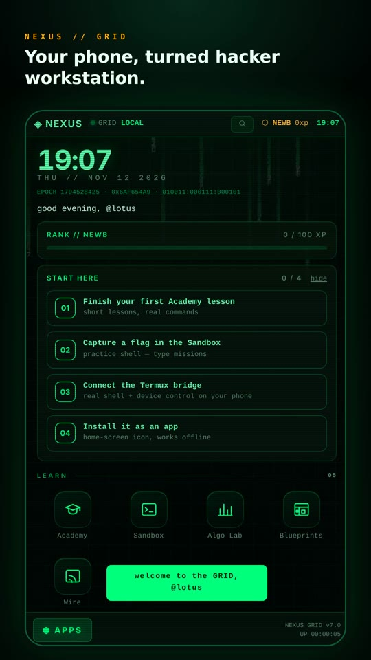
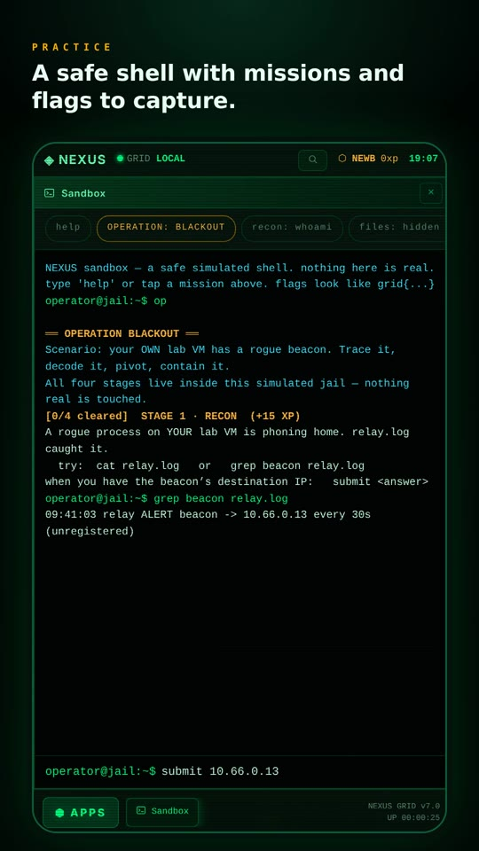
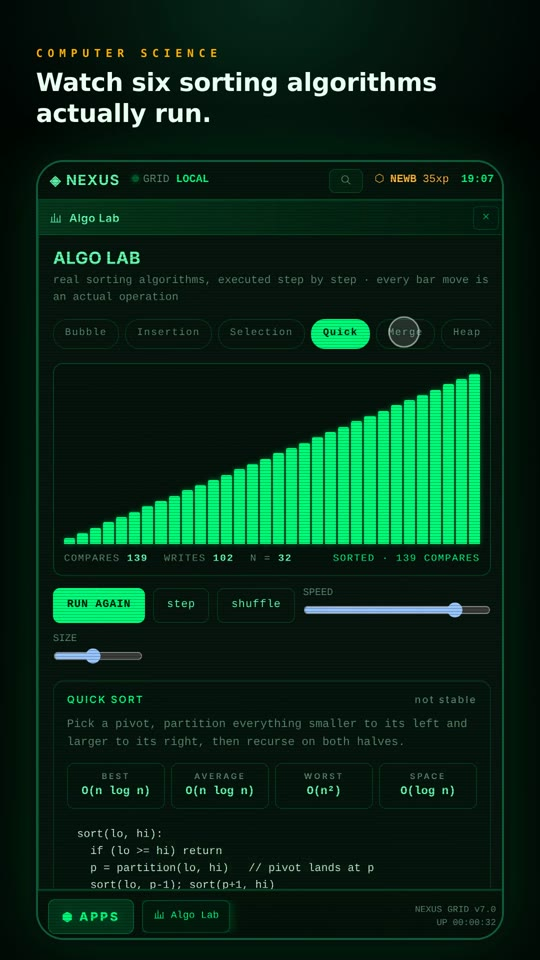

# NEXUS // GRID

**Turn your Android phone into a hacker workstation, and learn to use it.**

Free, open source, no ads, no accounts, no tracking. One HTML page that runs in any browser, installs to your home screen, and works offline. Nothing in it is simulated to look busy: if a screen is empty, it is because nobody has used it yet.

**Try it:** `https://Lotusborn19.github.io/nexus-grid/`

<p align="center">  </p>

> This is an early build looking for honest feedback. Open an issue and tell me what is confusing, broken, or pointless.

## What is in it

| | What it does |
|---|---|
| **Academy** | 16 short courses: Termux, Linux, Python, web security basics, computer science, electronics, robotics. |
| **Sandbox** | A practice shell with missions and flags, plus a four-stage story operation. It is a training jail: it never touches a real system. |
| **Algo Lab** | Six sorting algorithms running step by step, with compare counts, Big-O and code. |
| **Arcade** | Five small drills: trivia, a logic breach game, timing, memory, and binary. |
| **Shell, Control, System, Automation** | A real shell, device controls, process and file views, and scheduled jobs on **your own phone**, through the Termux bridge below. |
| **ORACLE** | A companion that runs on **your own** local model (Ollama). With no model connected it says so. It can open apps, switch themes, and drive a hobby robot. |
| **Blueprints** | Build guides from breadboard to a servo robot. |
| **Community** | Feed, crews, ideas board. These are local-only until a shared backend exists, and the app tells you that. |

## Install it as an app

**Easiest (any phone):** open the link above in Chrome, then menu **⋮ → Add to Home screen** (or **Install app**). It then opens full screen and works offline.

**Android APK:** every push builds an APK with GitHub Actions. Open the **Actions** tab, pick the latest *Build Android APK* run, and download `nexus-grid-apk`. It is a debug build signed with a throwaway key, so Android will ask you to allow installing from your browser or file manager.

## Real device control: the Termux bridge

The Device apps do nothing until you run the bridge on your own phone.

1. Install **Termux** and **Termux:API** from [F-Droid](https://f-droid.org) (not the Play Store version).
2. In Termux:
   ```sh
   pkg update && pkg upgrade -y
   pkg install python termux-api -y
   curl -O https://raw.githubusercontent.com/Lotusborn19/nexus-grid/main/bridge/nexus-bridge.py
   python nexus-bridge.py
   ```
3. It prints a **token**. In NEXUS open **Bridge**, paste the token, and run the connection test.

The bridge listens on `127.0.0.1` only and every request needs your token. The Shell app can run any command as your Termux user; set `ALLOW_SHELL = False` in the file to turn that off. Read the file before you run it. It is under 200 lines.

## Local AI and robot (optional)

- **ORACLE on your own model:** run [Ollama](https://ollama.com) on the phone or another machine, then set its URL in ORACLE → setup.
- **Robot:** `robot/robot-server.py` (Raspberry Pi + PCA9685) and `robot/robot-esp32.py` (MicroPython) accept the actions ORACLE sends. Both run in mock mode with no hardware attached.
- From the hosted `https://` page, browsers only allow plain-`http` connections to the phone itself (`127.0.0.1`). To reach a robot or model elsewhere on your Wi-Fi, use the Android APK.

## Ground rules

Use the device tools on **your own** phone and **your own** network. The Sandbox is the place to practice; nothing here is built to target systems you do not own.

## Privacy

Everything you do is stored in your browser's local storage on your device. There is no server, no analytics and no account. **Config → export my data** shows all of it.

## Build from source

The app is assembled from the part files in `src/`:

```sh
node src/build.js     # rewrites index.html
```

After changing the page, bump `VERSION` in `sw.js` so installed copies update.

## Feedback

Open an issue with the **Feedback** template. The most useful thing you can tell me is which part you would actually come back for.

## License

MIT. See `LICENSE`.
